<div align="center">

<!-- Animated Colorful ASCII Movement Art Header -->
<a href="https://github.com/jachinsamuel">
  
</a>

<!-- Dynamic Subtitle -->
[](https://github.com/jachinsamuel)

<br/>

<!-- Profile Navigation & Direct Links -->
[](https://jachin-portfolio.vercel.app/resume.pdf)
&nbsp;
[](https://linkedin.com/in/jachinsamuel/)
&nbsp;
[](mailto:jachinsamuel007@gmail.com)
&nbsp;
[](https://github.com/jachinsamuel)
&nbsp;
[](https://github.com/jachinsamuel)

<br/>

<!-- Deployed Applications -->
[](https://foodybuddy.shop)
&nbsp;
[](https://materncare.vercel.app/)
&nbsp;
[](https://voicecalc-5io4.onrender.com)

</div>

---

## Engineering Profile

```yaml
engineer:
  name: Jachin Samuel J
  role: Software Engineer | Full-Stack & Applied AI Developer
  education: B.Tech Computer Science and Engineering @ Karunya Institute of Technology and Sciences
  academic_standing: CGPA 8.93 / 10.0
  location: India
  core_stack:
    languages: [Python, TypeScript, JavaScript, C++, C]
    frontend: [React, Next.js, Tailwind CSS, Framer Motion]
    backend_systems: [FastAPI, Flask, PostgreSQL, SQLite, REST APIs]
    ai_infrastructure: [Ollama, Local RAG, Vector Search, LLM Integration]
  focus_domains:
    - Production Full-Stack Web Architecture
    - Local Retrieval-Augmented Generation (RAG) Pipelines
    - Transactional API Design and Optimization
    - Developer Tooling and Interactive Terminal Interfaces
  philosophy: "Ship high-utility products with clean system architecture and zero friction."
```

---

## Technical Arsenal

<div align="center">

### Languages


### Frontend Engineering


### Backend, Systems & Applied AI


### DevOps & Cloud Infrastructure


</div>

---

## Featured Engineering Projects

<div align="center">

| Project | Status | Tech Stack | Architectural Highlights | Direct Links |
| :--- | :---: | :--- | :--- | :---: |
| **FoodyBuddy** | Production | `React` `Flask` `PostgreSQL` `Razorpay` | Campus ordering platform featuring real-time state tracking, verified Razorpay payment webhooks, automated Twilio notifications, and merchant analytics. | [Live Application](https://foodybuddy.shop) |
| **Ace** | PyPI Release | `Python` `CLI` `TUI` `Ollama` | Intelligent terminal assistant translating natural language into safe Git commands, automating contextual commit generation, and providing an interactive TUI workflow. | [Source Code](https://github.com/jachinsamuel/Ace) |
| **Nexus** | Active | `Python` `FastAPI` `SQLite` `Ollama` | Enterprise-grade local RAG platform featuring a spatial glassmorphic interface, multi-provider LLM streaming, and local vector retrieval grounding with zero cloud egress. | [Source Code](https://github.com/jachinsamuel/RAG-Nexus) |
| **VoiceCalc** | Production | `Flask` `Web Speech API` `JavaScript` | Real-time speech-to-math parsing engine translating continuous spoken natural language queries into mathematical operations with sub-second execution. | [Live Application](https://voicecalc-5io4.onrender.com) |
| **MaternCare** | Production | `React` `Flask` `Recharts` `Scikit-Learn` | Clinical decision support platform utilizing supervised risk classification models to evaluate multi-parameter maternal health metrics with interactive telemetry dashboards. | [Live Application](https://materncare.vercel.app/) |

</div>

---

## Leadership & Engineering Experience

### Team Lead — Academic Software Projects
*Karunya Institute of Technology and Sciences* | *2025 – Present*

* Directed multi-disciplinary engineering teams across frontend, backend, and data persistence layers for full-stack and applied AI initiatives.
* Architected transaction processing workflows for **FoodyBuddy**, ensuring zero-loss state transitions during peak high-volume ordering periods.
* Engineered offline-first local AI architectures including **Nexus**, prioritizing low-latency inference and zero third-party token egress.
* Standardized team delivery practices through modular API contracts, schema migrations, and CI automation.

---

## Analytics & Activity

<div align="center">

<!-- Symmetrical Analytics Grid -->
<table border="0" width="100%">
  <tr>
    <td width="50%" valign="top">
      
    </td>
    <td width="50%" valign="top">
      <a href="https://github.com/jachinsamuel">
        
      </a>
    </td>
  </tr>
</table>

<br/>

<!-- Contribution Snake -->
<picture>
  <source media="(prefers-color-scheme: dark)" srcset="https://raw.githubusercontent.com/jachinsamuel/jachinsamuel/output/github-contribution-grid-snake-dark.svg"/>
  <source media="(prefers-color-scheme: light)" srcset="https://raw.githubusercontent.com/jachinsamuel/jachinsamuel/output/github-contribution-grid-snake.svg"/>
  
</picture>

</div>

---

## Contact & Collaboration

<div align="center">

*Open to discussing distributed system design, local AI and RAG architectures, and high-impact engineering roles.*

<br/>

[](https://jachin-portfolio.vercel.app/resume.pdf)
&nbsp;
[](https://linkedin.com/in/jachinsamuel/)
&nbsp;
[](https://github.com/jachinsamuel)
&nbsp;
[](mailto:jachinsamuel007@gmail.com)

</div>
