  <!-- 01. Animated Hero Banner -->
  

<!-- Verified Navigation & Professional Endpoints -->

  
  &nbsp;
  
  &nbsp;
  
  &nbsp;
  
  &nbsp;
  

<!-- 02. Terminal Workstation Dual-Pane -->

  
  &nbsp;&nbsp;
  

---

### Executive Profile & Institutional Standing

AI/ML and Systems Engineer with a core focus on **distributed software architectures**, **offline-first local RAG systems**, and **resilient full-stack web platforms**. Focused on engineering deterministic transaction workflows with verified state consistency, private edge AI pipelines with zero cloud data egress, and high-performance developer tooling.

| Benchmark | Institutional Record &amp; Distinctions | Engineering Domain |
| :--- | :--- | :--- |
| **Academic Standing** | B.Tech in Computer Science and Engineering @ **Karunya Institute of Technology and Sciences** | **CGPA 8.93 / 10.0** (2025 – Present) |
| **Engineering Leadership** | Academic Project Team Lead directing multi-tier software projects | System Architecture, APIs &amp; UX |
| **Open Source Author** | Published author of [`Ace`](https://github.com/jachinsamuel/Ace) distributed globally via **PyPI** | Developer Tooling &amp; CLI Agents |
| **Production Architecture** | Architected [FoodyBuddy](https://foodybuddy.shop) campus dining &amp; payments platform | High-Concurrency State Management |

---

### Featured Engineering Systems

| System &amp; Status | Architecture &amp; Telemetry Highlights | Verified Tech Stack | Deployment &amp; Code |
| :--- | :--- | :--- | :---: |
| **[FoodyBuddy](https://foodybuddy.shop)**  Campus Dining Platform | High-concurrency campus ordering ecosystem built for peak mealtime spikes. Engineered with real-time order state synchronization, verified Razorpay payment webhook reconciliation, automated Twilio merchant SMS notifications, and operations analytics. |      | [**Visit Platform ↗**](https://foodybuddy.shop) |
| **[Ace](https://github.com/jachinsamuel/Ace)**  Terminal AI Copilot | Intelligent command-line copilot translating conversational developer intent into verified Git commands, drafting contextual semantic commit messages, and providing an interactive terminal UI workflow. Packaged and distributed via PyPI. |     | [**PyPI Package ↗**](https://pypi.org/project/ace-cli/) [**Source Code ↗**](https://github.com/jachinsamuel/Ace) |
| **[Nexus](https://github.com/jachinsamuel/RAG-Nexus)**  Enterprise Local RAG | Self-contained local knowledge retrieval platform featuring spatial glassmorphic UI, multi-provider local LLM streaming inference via Ollama, and vector similarity indexing operating with absolute zero cloud data egress. |     | [**Source Code ↗**](https://github.com/jachinsamuel/RAG-Nexus) |
| **[MaternCare](https://materncare.vercel.app/)**  Clinical Decision Telemetry | Healthcare clinical decision support platform employing supervised machine learning models to assess multi-parameter maternal vital signs and surface real-time risk classification through responsive telemetry dashboards. |     | [**Live Application ↗**](https://materncare.vercel.app/) |
| **[VoiceCalc](https://voicecalc-5io4.onrender.com)**  Speech-to-Math Engine | Continuous speech parsing engine converting conversational spoken arithmetic into parsed mathematical AST expressions with real-time speech synthesis feedback and sub-second execution. |     | [**Live Application ↗**](https://voicecalc-5io4.onrender.com) |

---

### Technical Arsenal

| Core Languages &amp; Systems | Frontend Architecture | Backend &amp; Applied AI | DevOps &amp; Infrastructure |
| :--- | :--- | :--- | :--- |
|  |  |  |  |
|  |  |  |  |
|  |  |  |  |
|  |  |  |  |
|  |  |  |  |
|  | |  |  |

---

### Verified Contribution Heatmap

  

---

### Direct Inquiries & Collaboration

  <em>Open to discussing distributed system architectures, offline-first AI pipelines, and high-impact engineering opportunities.</em>

  
  &nbsp;
  
  &nbsp;
  
  &nbsp;
  
  &nbsp;
  

  <!-- 09. Minimal Animated SVG Footer -->
  

