<!-- Animated Chromatic ASCII Movement Art Header -->

 
 

<!-- Real Animated Contribution Heatmap -->
<h3><code>jachin@github ~ $ ./contributions.sh</code></h3>

 
 

<!-- Terminal ASCII Portrait + Neofetch Info Card -->
<h3><code>jachin@github ~ $ whoami --spec</code></h3>

<table>
  <tr>
    <td valign="top"></td>
    <td valign="top"></td>
  </tr>
</table>

 
 

<!-- Quick Navigation & Live Deployments -->
<h3><code>jachin@github ~ $ ./deployments.sh</code></h3>

&nbsp;

&nbsp;

&nbsp;

 

&nbsp;

&nbsp;

---

## Technical Arsenal

### Languages

### Frontend Engineering

### Backend, Systems & Applied AI

### DevOps & Cloud Infrastructure

---

## Featured Engineering Projects

| Project | Status | Tech Stack | Architectural Highlights | Direct Links |
| :--- | :---: | :--- | :--- | :---: |
| **FoodyBuddy** |  | `React` `Flask` `PostgreSQL` `Razorpay` | Campus ordering platform featuring real-time state tracking, verified Razorpay payment webhooks, automated Twilio notifications, and merchant analytics. | [Live Application](https://foodybuddy.shop) |
| **Ace** |  | `Python` `CLI` `TUI` `Ollama` | Intelligent terminal assistant translating natural language into safe Git commands, automating contextual commit generation, and providing an interactive TUI workflow. | [Source Code](https://github.com/jachinsamuel/Ace) |
| **Nexus** |  | `Python` `FastAPI` `SQLite` `Ollama` | Enterprise-grade local RAG platform featuring a spatial glassmorphic interface, multi-provider LLM streaming, and local vector retrieval grounding with zero cloud egress. | [Source Code](https://github.com/jachinsamuel/RAG-Nexus) |
| **VoiceCalc** |  | `Flask` `Web Speech API` `JavaScript` | Real-time speech-to-math parsing engine translating continuous spoken natural language queries into mathematical operations with sub-second execution. | [Live Application](https://voicecalc-5io4.onrender.com) |
| **MaternCare** |  | `React` `Flask` `Recharts` `Scikit-Learn` | Clinical decision support platform utilizing supervised risk classification models to evaluate multi-parameter maternal health metrics with interactive telemetry dashboards. | [Live Application](https://materncare.vercel.app/) |

---

## Leadership & Engineering Experience

### Team Lead — Academic Software Projects
*Karunya Institute of Technology and Sciences* | *2025 – Present*

* Directed multi-disciplinary engineering teams across frontend, backend, and data persistence layers for full-stack and applied AI initiatives.
* Architected transaction processing workflows for **FoodyBuddy**, ensuring zero-loss state transitions during peak high-volume ordering periods.
* Engineered offline-first local AI architectures including **Nexus**, prioritizing low-latency inference and zero third-party token egress.
* Standardized team delivery practices through modular API contracts, schema migrations, and CI automation.

---

## Contribution Activity

<!-- Contribution Snake Animation -->
<picture>
  <source media="(prefers-color-scheme: dark)" srcset="https://raw.githubusercontent.com/jachinsamuel/jachinsamuel/output/github-contribution-grid-snake-dark.svg"/>
  <source media="(prefers-color-scheme: light)" srcset="https://raw.githubusercontent.com/jachinsamuel/jachinsamuel/output/github-contribution-grid-snake.svg"/>
  
</picture>

---

## Contact & Collaboration

*Open to discussing distributed system design, local AI and RAG architectures, and high-impact engineering roles.*

 

&nbsp;

&nbsp;

&nbsp;

