<!-- 01. Animated Hero Banner (Blue Visual System) -->

 
 

<!-- Verified Professional & Technical Profiles -->

&nbsp;

&nbsp;

&nbsp;

&nbsp;

 

---

### Executive Profile

AI/ML and Systems Engineer with a deep focus on **distributed software architectures**, **offline-first local RAG systems**, and **resilient full-stack web platforms**. Experienced in architecting transactional workflows with strict state consistency, engineering private edge AI pipelines with zero cloud data egress, and leading multi-disciplinary engineering initiatives from inception to production deployment.

Currently pursuing a **B.Tech in Computer Science and Engineering** at **Karunya Institute of Technology and Sciences** with an academic standing of **CGPA 8.93 / 10.0**.

---

### Terminal Telemetry & Verification

<h3><code>jachin@systems ~ $ whoami --spec</code></h3>

<table>
  <tr>
    <td valign="top"></td>
    <td valign="top"></td>
  </tr>
</table>

#### Verified Credentials & Institutional Standing

* **Academic Distinction**: B.Tech in Computer Science and Engineering @ Karunya Institute of Technology and Sciences — **CGPA 8.93 / 10.0** (2025 – Present).
* **Engineering Leadership**: Team Lead directing multi-tier software projects across database persistence, API gateways, and user experience layers.
* **Published Open Source Package Author**: Author & maintainer of [`Ace`](https://github.com/jachinsamuel/Ace), an AI Git copilot published on the official **Python Package Index (PyPI)**.
* **Production Deployment Architecture**: Engineered **FoodyBuddy**, a live campus ordering system featuring verified Razorpay payment webhooks and automated Twilio merchant alerts.

---

### Selected Engineering Projects

| Project | Status | Tech Stack | Architectural Highlights | Direct Links |
| :--- | :---: | :--- | :--- | :---: |
| **FoodyBuddy** |  | `React` `Flask` `PostgreSQL` `Razorpay` `Twilio` | Production campus dining and merchant management platform featuring real-time state tracking, verified Razorpay payment webhooks, automated Twilio notifications, and merchant analytics. | [Live Application](https://foodybuddy.shop) |
| **Ace** |  | `Python` `CLI` `TUI` `Ollama` | Intelligent terminal assistant translating natural language intent into safe Git commands, automated commit summaries, and interactive TUI workflow. Published to PyPI. | [Source Code](https://github.com/jachinsamuel/Ace) |
| **Nexus** |  | `Python` `FastAPI` `SQLite` `Ollama` `Vector Search` | Enterprise-grade offline-first RAG platform featuring spatial glassmorphic architecture, local LLM streaming, and local vector retrieval with zero cloud data egress. | [Source Code](https://github.com/jachinsamuel/RAG-Nexus) |
| **VoiceCalc** |  | `Flask` `Web Speech API` `JavaScript` `CSS3` | Real-time speech-to-math parsing engine translating continuous spoken natural language queries into mathematical operations with sub-second execution. | [Live Application](https://voicecalc-5io4.onrender.com) |
| **MaternCare** |  | `React` `Flask` `Recharts` `Scikit-Learn` | Clinical decision support platform utilizing supervised risk classification models to evaluate multi-parameter maternal health telemetry with interactive analytics dashboards. | [Live Application](https://materncare.vercel.app/) |

---

### Technical Arsenal

#### Core Languages

#### Frontend Engineering

#### Backend, Systems & Applied AI

#### DevOps, Infrastructure & Tooling

---

### Contribution Heatmap

<h3><code>jachin@systems ~ $ ./contributions.sh --verified</code></h3>

---

### Telemetry & Development Statistics

<h3><code>jachin@systems ~ $ ./stats.sh --telemetry</code></h3>

 
 

<!-- Dynamic Contribution Snake -->
<picture>
  <source media="(prefers-color-scheme: dark)" srcset="https://raw.githubusercontent.com/jachinsamuel/jachinsamuel/output/github-contribution-grid-snake-dark.svg"/>
  <source media="(prefers-color-scheme: light)" srcset="https://raw.githubusercontent.com/jachinsamuel/jachinsamuel/output/github-contribution-grid-snake.svg"/>
  
</picture>

---

### Connect & Collaborate

*Open to discussing distributed system design, local AI and RAG architectures, and high-impact engineering opportunities.*

 

&nbsp;

&nbsp;

&nbsp;

 
 

<!-- 09. Minimal Animated SVG Footer -->

